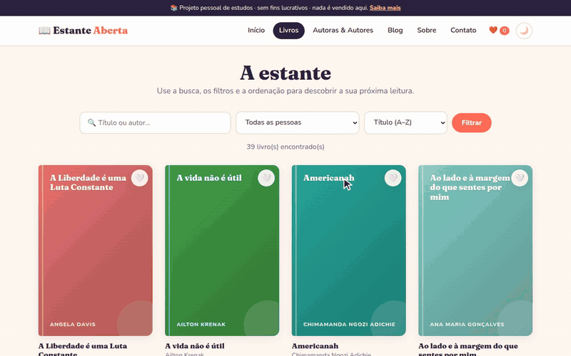
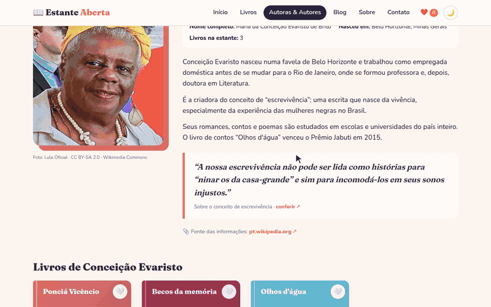
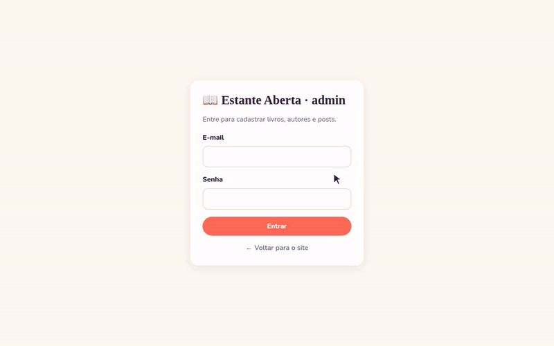

# 📖 Estante Aberta

> **Projeto pessoal de estudos, sem fins lucrativos.** Nada é vendido aqui.

Um site com cara de blog de leitura que apresenta autoras e autores negros, indígenas e
brasileiros: biografias com fotos e fontes, os livros de cada um, um blog com comentários,
favoritos e um painel de administração.

Feito com **PHP puro + SQLite (PDO)**, sem frameworks, organizado do jeito que um projeto
profissional seria, mas pensado para quem está aprendendo.


---

## 🎬 Demonstração

### Busca, filtros e ordenação
Busca por título ou autor, filtro por pessoa e ordenação, tudo feito com `$_GET` e SQL.



### Modo claro e escuro
O site segue o tema do sistema e tem um botão ☀️/🌙 que lembra a sua escolha.



### Painel de administração
Login com senha criptografada e cadastro de livros, autores e posts.



### No celular
O layout se adapta a telas pequenas.


---

## 🚀 Como rodar

Precisa do **PHP 8.1+** com a extensão `pdo_sqlite`.

```bash
git clone https://github.com/manoela-alves-silva/Biblioteca-Virtual.git
cd Biblioteca-Virtual
php -S localhost:8000 -t public
```

Abra **http://localhost:8000**.

Na primeira vez, o banco `database/banco.sqlite` é criado e preenchido sozinho.

### Painel de administração

**http://localhost:8000/admin**

| E-mail                | Senha inicial |
|-----------------------|---------------|
| admin@estante.local   | estante123    |

> 🔑 Essa é só a senha **de desenvolvimento**, criada pelo instalador. Troque em
> **Admin → Trocar senha**. Se um dia publicar o site, troque antes de qualquer coisa.

### Recomeçar o banco do zero

```bash
php database/instalar.php
```

> ⚠️ Isso apaga tudo que foi cadastrado pelo admin e volta aos dados iniciais.

---

## 🗂️ Estrutura (e o porquê de cada pasta)

```
Biblioteca-Virtual/
├── public/              ← A ÚNICA pasta que o navegador enxerga
│   ├── index.php        ← páginas do site
│   ├── livros.php · livro.php · autores.php · autor.php
│   ├── blog.php · post.php · favoritos.php · sobre.php · contato.php
│   ├── admin/           ← painel (login, cadastro de livros/autores/posts, comentários)
│   ├── css/             ← estilo.css (site) e admin.css (painel)
│   ├── js/tema.js       ← botão de modo claro/escuro
│   └── img/autores/     ← fotos (as enviadas pelo admin também vêm pra cá)
│
├── src/                 ← a "lógica" do sistema (o navegador NÃO acessa)
│   ├── bootstrap.php    ← liga tudo: config, classes, sessão, banco
│   ├── Banco.php        ← conexão PDO
│   ├── Repositorios/    ← TODO o SQL fica aqui, um arquivo por tabela
│   ├── Favoritos.php    ← favoritos guardados na sessão
│   ├── Autenticacao.php ← login/logout do admin
│   ├── Upload.php       ← envio seguro de fotos
│   └── funcoes.php      ← ajudantes: e(), flash(), csrf, paragrafos()...
│
├── views/               ← pedaços de HTML reaproveitados
│   ├── layout/          ← cabeçalho e rodapé do site
│   ├── admin/           ← cabeçalho e rodapé do painel
│   └── componentes/     ← card de livro, card de post, capa, foto, paginação...
│
├── docs/gifs/           ← os GIFs de demonstração deste README
│
├── database/
│   ├── schema.sql          ← as tabelas
│   ├── dados-iniciais.php  ← autores, livros e posts iniciais
│   ├── instalar.php        ← cria o banco
│   └── banco.sqlite        ← o banco em si (gerado, não vai pro git)
│
└── config.php           ← configurações (nome do site, itens por página...)
```

**Por que `public/` separada?** Só o que está ali pode ser aberto pelo navegador. Assim
ninguém consegue baixar o `config.php`, o banco ou ver o código de `src/`.

**Por que Repositórios?** As páginas não escrevem SQL. Elas pedem
`$livros->porId(3)` e pronto. Se um dia você trocar SQLite por MySQL, só os
repositórios mudam. É a mesma ideia dos *Models* do Laravel.

### Como uma página funciona

Toda página segue a mesma receita:

```php
<?php
require __DIR__ . '/../src/bootstrap.php';   // 1. liga o sistema

$livro = $livros->porId($_GET['id']);        // 2. busca os dados
if (!$livro) pagina_nao_encontrada();

$titulo = $livro['titulo'];                  // 3. mostra o HTML
require RAIZ . '/views/layout/cabecalho.php';
?>
<h1><?= e($livro['titulo']) ?></h1>
<?php require RAIZ . '/views/layout/rodape.php'; ?>
```

### Como o modo escuro funciona

Todas as cores ficam em **variáveis CSS** (`--fundo`, `--texto`...) no topo do
`estilo.css`. O modo escuro não repete o CSS: ele só troca o valor dessas variáveis.
O `js/tema.js` lembra a escolha do botão ☀️/🌙. A tag `<meta name="darkreader-lock">`
avisa a extensão Dark Reader para não mexer, já que o site tem modo escuro próprio.

---

## ✨ Funcionalidades

**Site**
- 14 autoras e autores com biografia, foto (com crédito) e **fonte com link**
- Citações **conferidas**: cada uma mostra de onde veio (livro ou palestra) e um link para conferir
- 39 livros com capas ilustradas geradas em CSS
- Busca por título/autor, filtro por autor, ordenação e paginação
- Página de cada livro com "mais do mesmo autor"
- Favoritos ❤️ (na sessão)
- Blog com comentários
- Página **Sobre o projeto** com os créditos de todas as fotos
- Formulário de contato (exercício de validação: não envia nada)
- **Modo claro e escuro**, com botão
- Página 404 personalizada
- Layout responsivo (funciona no celular)

**Painel admin**
- Login com senha criptografada (`password_hash`) e página para **trocar a senha**
- Cadastrar, editar e excluir livros, autores e posts
- Citação só é aceita com fonte e link (o formulário não deixa salvar sem)
- Upload de foto do autor (valida tipo e tamanho)
- Moderar comentários
- Painel mostra quem ainda está **sem foto ou sem fonte**

**Segurança (o básico que todo site precisa)**
- `e()` em tudo que vai pra tela → evita **XSS**
- `prepare()` com parâmetros → evita **SQL Injection**
- Token **CSRF** em todos os formulários POST
- Padrão **POST → Redirect → GET** (F5 não reenvia formulário)
- Upload confere o conteúdo real do arquivo, não só a extensão
- `mostrar_erros` no `config.php`: erros do PHP só aparecem na tela durante o desenvolvimento

---

## 📚 O que este projeto ensina

| Conceito                      | Onde ver                                   |
|-------------------------------|--------------------------------------------|
| Arrays, `foreach`, funções    | `src/funcoes.php`, todas as páginas        |
| `include`/`require`           | `views/componentes/`                       |
| `$_GET` e `$_POST`            | `public/livros.php`, `public/contato.php`  |
| `$_SESSION`                   | `src/Favoritos.php`, `src/Autenticacao.php`|
| `$_FILES` (upload)            | `src/Upload.php`, `public/admin/autor-form.php` |
| Classes e objetos (POO)       | `src/Repositorios/`                        |
| PDO, SQL, JOIN, transações    | `src/Repositorios/`, `database/`           |
| Variáveis CSS e modo escuro   | `public/css/estilo.css`, `public/js/tema.js` |

---

## ⚖️ Aviso

Este é um **projeto pessoal de estudos, sem fins lucrativos**. Não há loja, venda nem
pagamento. As biografias são resumos feitos a partir de fontes públicas, indicadas em
cada página. As capas são ilustrações genéricas e não reproduzem as originais. Títulos,
obras e nomes pertencem aos seus autores e editoras.

### Sobre as citações

Só entram citações que foram **conferidas** numa fonte. Frases muito compartilhadas na
internet, mas sem origem comprovada, ficam de fora. Por isso nem todo autor tem citação.

### Licença

O **código** está sob a [licença MIT](LICENSE): pode estudar, copiar e reaproveitar.
Ela não vale para as fotos, que seguem as licenças do Wikimedia Commons indicadas
abaixo, nem para os textos e obras dos autores citados.

### Créditos das fotos

As fotos com crédito vêm do [Wikimedia Commons](https://commons.wikimedia.org), com
licenças livres. A lista completa (autor da foto e licença) aparece na página **Sobre**
do site. Luiz Antonio Simas ainda não tem foto livre e aparece com um avatar ilustrado.

---

## 🔮 Próximas ideias

- [ ] Foto com licença livre para o Luiz Antonio Simas
- [ ] Gêneros/categorias de livros (tabela `categorias` + filtro)
- [ ] Migrar para MySQL (só mudar `Banco.php` e o `schema.sql`)
- [ ] Reescrever em Laravel e comparar!
